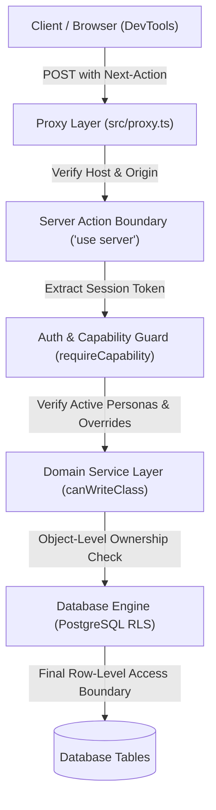

# Infrastructure Health, Reliability, and Observability

This guide details the vendor-neutral health probing, request tracing, observability, and zero-trust security architecture across Cert-Ed.

---

## 1. Cloud Infrastructure Health Probing Architecture

Upstream infrastructure (ingress controllers, edge traffic managers, container orchestrators, and load balancers) requires reliable mechanisms to determine when application instances are alive and ready to receive user traffic.

### A. Health Endpoint Hierarchy

| Endpoint                | Target Consumer                         | Database Interaction            | HTTP Response Codes                                        | Purpose                                                                                                                          |
| :---------------------- | :-------------------------------------- | :------------------------------ | :--------------------------------------------------------- | :------------------------------------------------------------------------------------------------------------------------------- |
| **`/api/health/live`**  | Load balancers, container orchestrators | **Zero (0 DB calls)**           | `200 OK`                                                   | **Liveness Probe**: Proves the Node.js/Next process is active and accepting connections. Fast and resilient to DB network blips. |
| **`/api/health/ready`** | Synthetic monitors, traffic managers    | **Read-only ping (`SELECT 1`)** | `200 OK` (healthy)<br>`503 Service Unavailable` (degraded) | **Readiness Probe**: Verifies database connectivity and returns round-trip latency (`latencyMs`) before routing traffic.         |
| **`/api/health`**       | External uptime pingers                 | **Memoized (30s TTL)**          | `200 OK` (`{ ok: true, db: boolean }`)                     | **Keep-Warm Target**: Preserves legacy keep-warm behavior without database connection thrashing.                                 |

### B. Root Path Probe Flapping Immunity

Many cloud infrastructure monitors check `/` by default. On authenticated applications with dual-host routing (marketing vs. portal app):

- An unauthenticated request to `/` on the app host is normally redirected to `/login` via `307 Temporary Redirect`.
- Automated cloud probes often treat 3xx redirects as **Unhealthy**, triggering container restart loops or 503 cascades.

**Resolution in `src/proxy.ts`**:
The proxy detects automated probe agents via `isHealthProbeRequest()` (inspecting probe signatures like `readyforrequest`, `healthcheck`, `trafficmanager`, and `application-gateway`). When an automated probe targets `/`, the proxy answers immediately with `200 OK` (`{ ok: true, status: 'healthy', probe: true }`) with `Cache-Control: no-store`, preventing 307 redirect flapping.

### C. Universal Health Exemption

Health endpoints (`/api/health*`) are exempt from session authentication:

1. They bypass `updateSession()`, saving a Supabase Auth network call on every probe.
2. They are served in place on both the app host and marketing host without cross-host redirects.
3. They are included in `BROWSER_NAVIGABLE_API`, ensuring browser-based inspections do not rewrite to `/_not-found`.

---

## 2. Universal Request Correlation & Tracing

Debugging issues across distributed services, proxies, and error trackers requires a single correlated request identifier.

### How Request Correlation Works

1. **Proxy Ingress (`src/proxy.ts`)**:
   Upon receiving any request, the proxy resolves a correlation ID:
   ```ts
   const requestId =
     request.headers.get('x-request-id') ??
     request.headers.get('x-correlation-id') ??
     request.headers.get('x-vercel-id') ??
     `req_${crypto.randomUUID().replace(/-/g, '').slice(0, 16)}`
   ```
2. **Downstream Propagation**:
   The proxy stamps `x-request-id` onto downstream request headers for Next.js Server Components and Server Actions.
3. **Response Header Tagging**:
   The proxy sets `X-Request-Id: <requestId>` on outgoing browser responses, allowing users and developers to locate the exact trace ID in browser DevTools.
4. **Structured Server Logging (`src/lib/observability/log.ts`)**:
   `logError()` automatically includes `requestId` in structured console outputs:
   ```
   [context] error message { requestId: 'req_...', stack: '...' }
   ```
5. **Sentry Error Tracking (`src/lib/observability/request-context.ts`)**:
   Every request tags the Sentry isolation scope with `request_id` and `vercel_id`, allowing operators to query Sentry events by request ID.

---

## 3. Zero-Trust Security Against Client-Side / DevTools Tampering

In modern full-stack web applications, the client environment (DOM, form inputs, local storage, DevTools) must be treated as completely untrusted.

### Architectural Defense Layers



1. **Server-Side Execution Guarantee**:
   All data mutations execute exclusively in Server Actions (`'use server'`). Removing `disabled="true"`, toggling CSS `display: none`, or invoking `fetch()` directly in the DevTools console cannot bypass server logic.
2. **Authentication & Capability Gating**:
   Every server action verifies the caller's session JWT and requires specific capabilities:
   ```ts
   const me = await requireCapability('manageUsers')
   ```
   A caller cannot forge or elevate capabilities; they are resolved strictly from the database.
3. **Object-Level Authorization (IDOR Defense)**:
   Even with valid capabilities, domain commands enforce scoped ownership:
   - `canWriteClass(actor, classId)` verifies class tutor/admin assignment.
   - `mentorsStudent(actor.id, studentId)` verifies pastoral assignment.
   - `canWriteCalendar(actor, classId)` gates timetable and event updates.
4. **Static Analysis CI Verification (`tests/unit/security/server-action-guards.test.ts`)**:
   An automated regression test audits every `'use server'` file across the codebase to ensure no server action exists without an authorization check or distributed rate limit.

---

## 4. Maintenance & Scaling Guidelines

1. **Connection Pool Protection**:
   Configure container liveness probes to use `/api/health/live` to avoid putting unnecessary load on database connection pools during autoscaling events.
2. **Distributed Throttling**:
   Use `rateLimitShared` (`rate_limit_counters` table) for unauthenticated or expensive operations (registration, password reset, bulk exports) to maintain consistent ceilings across multiple instances.
3. **DTO Scrubbing (Information Disclosure Prevention)**:
   When rendering Server Components, project database entities into explicit DTOs before passing them as props to Client Components, preventing hidden database columns from leaking into the React Server Component (RSC) flight payload.
